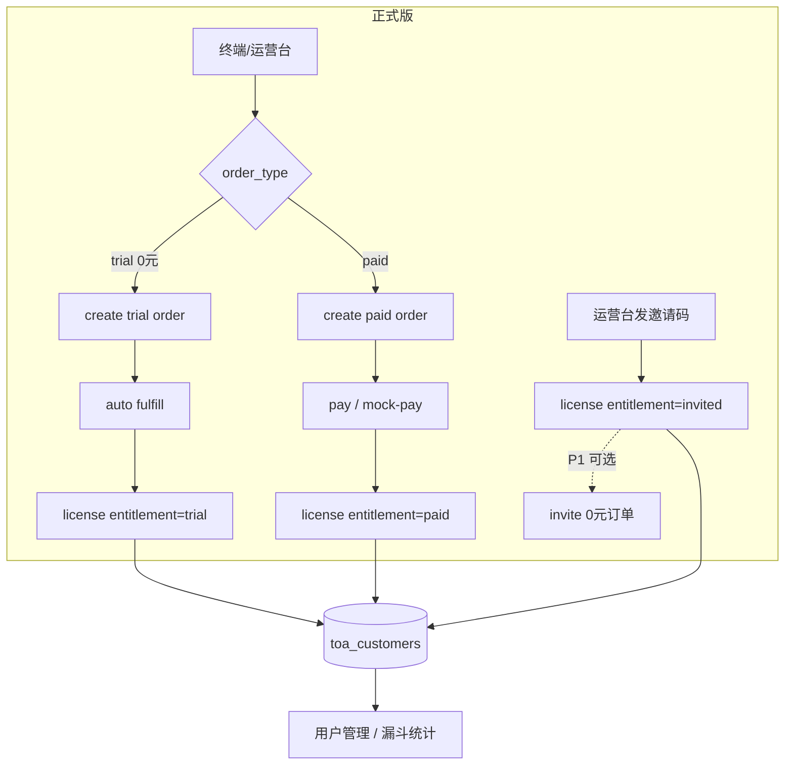

# 26 · 订单 enriched + 用户统一 + 版本体系（规划）

> 状态：**规划稿 · 待主理人确认**（2026-08）  
>  supersede 部分口径：`25-体验版与付费版授权模型.md` §1、§4  
> 关联：`22-菜单与功能包分层维护.md`、`23-运营台与终端设置职能边界.md`

---

## 1. 版本体系（新裁定）

### 1.1 两级结构

```text
TOA3 发行
├── 开发版（dev）          … 内部联调；DEV_GRANT_ALL / 不对外售卖
└── 正式版（release）      … Inno 安装包 · stable/beta 渠道
         ├── 授权版         … 主理人/运营邀请码（VIP、内测、合作方）
         ├── 体验版         … 0 元试用订单 · 有期限 · 到期全收回
         └── 付费版         … 正价订单 · 基础永久 + 方案模块按期限
```

| 层级 | 终端入口 | 云侧 `entitlement` | 商业含义 |
|------|----------|-------------------|----------|
| **开发版** | 开发包 / 环境变量 | — | 不进入 CRM |
| **授权版** | 正式版登录 + **邀请码** | `invited` | 你主动发的码；可配方案+期限；**不计价、不走过期转付费漏斗**（或单独策略） |
| **体验版** | 正式版登录 + 试用申请 / 运营台代开 | `trial` | **0 元订单**；识别潜在客户；跟踪试用→付费转化 |
| **付费版** | 正式版登录 + 购买/续费 | `paid` | 正价订单；基础板块永久 |

**与旧口径对照**

| 旧说法 | 新归属 |
|--------|--------|
| 单机「体验版登录」 | 正式版 · **离线 local_free**（未进云 CRM；可选登记「匿名线索」P2） |
| 授权管理直接发卡 | 默认改为 **授权版**（邀请）；体验走 **0 元订单** |
| 订单管理仅付费 | 扩展为 **全部履约单**（paid / trial / 可选 invite） |

---

## 2. 统一用户（CRM 核心）

### 2.1 问题

现状：`toa_licenses` 与 `toa_orders` 各记各的，同一手机号分散在授权台账、订单表；无法回答：

- 有多少**潜在客户**（领过体验）？
- 试用**是否到期**、**是否续费**？
- 邀请用户与付费用户是否同一人？

### 2.2 新表 `toa_customers`（云 · 唯一用户主数据）

| 字段 | 说明 |
|------|------|
| `id` | PK |
| `phone` | **唯一键**（11 位） |
| `name` | 最近使用的显示名 |
| `company` | 可选 |
| `source` | `admin` / `terminal_trial` / `terminal_purchase` / `import` |
| `lifecycle` | 见 §2.3 |
| `first_seen_at` / `last_active_at` | 首次/末次活跃 |
| `trial_count` | 体验次数（防刷） |
| `paid_order_count` | 付费订单数 |
| `total_paid_yuan` | 累计实付 |
| `current_entitlement` | 当前最高身份：`none` / `trial` / `invited` / `paid` |
| `current_plan_id` | 当前方案 |
| `current_expire_date` | 当前授权到期日 |
| `remark` | 运营备注 |

**关联**

- `toa_orders.customer_id` → FK
- `toa_licenses.customer_id` → FK（保留 phone 冗余便于查询）

### 2.3 用户生命周期 `lifecycle`

```text
lead          … 仅有手机号/线索，未激活
trialing      … 体验版有效中
trial_expired … 体验已到期、未付费
invited       … 授权版有效中（邀请码）
paid_active   … 付费版有效中
paid_lapsed   … 付费曾有效、方案模块已到期（基础仍可用）
churned       … 长期无活跃（规则可配，如 180 天）
```

**自动推导规则（只读计算，可缓存）**

| 条件 | lifecycle |
|------|-----------|
| 无 license、无 fulfilled 订单 | `lead` |
| 最近 entitlement=trial 且未过期 | `trialing` |
| 曾 trial 且全过期、无 paid fulfilled | `trial_expired` |
| 最近 entitlement=invited 且未过期 | `invited` |
| 最近 entitlement=paid 且未过期 | `paid_active` |
| paid 过期 | `paid_lapsed` |

### 2.4 运营台「用户管理」（新侧栏）

**列表列**：姓名 · 手机 · 生命周期 · 当前身份 · 方案 · 到期 · 累计付费 · 末次活跃

**详情抽屉 / 页**（单用户 360°）

| Tab | 内容 |
|-----|------|
| 概览 | lifecycle、当前码指纹、绑机、快捷动作 |
| 订单 | 全部订单（trial/paid/invite）时间线 |
| 授权 | 历史 license 码（含已吊销） |
| 操作 | 发邀请码、代开体验、建付费订单、写备注 |

**与授权管理关系**

- **授权管理** → 收窄为「发邀请码 / 查码 / 解绑同步」快捷入口，**台账主视图迁入用户管理**
- 或保留授权管理为「码视角」，用户管理为「人视角」，底层同一 `customer_id`

---

## 3. 订单 enriched

### 3.1 订单类型 `order_type`

| `order_type` | 金额 | 履约 | entitlement | 用途 |
|--------------|------|------|-------------|------|
| `paid` | 方案定价 | 收款后发卡 | `paid` | 正式商业 |
| `trial` | **0** | **创建即履约**（或激活后履约） | `trial` | 潜在客户、试用跟踪 |
| `invite` | 0 | 可选：与授权管理联动记一笔 | `invited` | 邀请漏斗统计（P1，可省） |

### 3.2 表 `toa_orders` 扩展

| 新增字段 | 说明 |
|----------|------|
| `order_type` | `paid` / `trial` / `invite` |
| `customer_id` | FK → toa_customers |
| `entitlement` | 履约目标身份（与 license 一致） |
| `trial_seq` | 该用户第几次试用（1,2,…） |
| `parent_order_no` | 续费/转化来源订单（trial → paid 链路） |
| `expires_at` | 冗余：到期日（= 履约日 + license_days） |

**状态机（统一）**

```text
pending → fulfilled → (license 过期后订单本身仍 fulfilled，用 lifecycle 表示后续)
        ↘ cancelled
```

- **trial**：创建后 `amount_yuan=0`，跳过支付，`status=fulfilled`，立即 `issue_license_for_order(entitlement=trial)`
- **paid**：保持现有 pending → mock-pay / webhook → fulfilled

### 3.3 试用防刷（沿用 + 加强）

| 规则 | 配置 |
|------|------|
| 每手机号 trial 次数上限 | `commerce.yml` → `trial.max_per_phone`（默认 1） |
| 每机器 trial 次数上限 | `trial.max_per_machine` |
| 两次 trial 最小间隔 | `trial.cooldown_days` |
| 已有 paid 历史 | 禁止再 trial（或需运营 override） |

违规时：订单 `status=cancelled`，reason 写入 remark，**仍留 customer 记录**（计入「尝试试用」线索）。

### 3.4 转化与续费跟踪

**关键指标（概览 Dashboard）**

| 指标 | 计算 |
|------|------|
| 潜在客户数 | `lifecycle in (lead, trialing, trial_expired)` 或有过 trial 订单 |
| 试用中 | `trialing` |
| 试用到期未转化 | `trial_expired` |
| 试用→付费转化率 | 有 trial fulfilled 且后续有 paid fulfilled 的用户 / 试用用户 |
| 续费率 | 到期前 30 天内新增 paid 订单的用户 / 将到期 paid 用户 |
| ARPU | `sum(total_paid_yuan) / paid 用户数` |

**订单列表增强（你截图里的表）**

新增列：**类型**（付费/体验/邀请）· **生命周期** · **到期** · **转化**（是否已有后续 paid 单）

筛选：全部 / 付费 / 体验 / 邀请 / 待转化（trial fulfilled 且无 paid）

### 3.5 流程图



---

## 4. 三版授权策略（门禁 recap）

| 身份 | 有效期内 | 过期后 |
|------|----------|--------|
| **invited 授权版** | 按邀请方案 feature | **按邀请策略**（默认：同 trial 全收回；VIP 可配置延期/永久） |
| **trial 体验版** | 方案内全开 | 全部收回 → 引导付费 |
| **paid 付费版** | 方案 module | 基础永久 + 付费 module 锁定 |

终端 `license.json`：`edition=release`，`entitlement=invited|trial|paid`。

**邀请码与体验码分离**

- 授权管理 UI：**授权类型** = `invited`（默认）/ `trial`（代开体验，应改走创建 trial 订单）
- 体验尽量 **只走订单**，避免双入口数据不一致

---

## 5. 产品方案（SKU）调整

| 方案 | sellable | 用于 |
|------|----------|------|
| `local_free` | false | 单机离线层；不出现在订单 |
| `trial_starter`（新建） | true，**price=0** | 体验专用 SKU；`validity_days=14` |
| `starter` / 各 suite | true，正价 | 付费订单 |

体验订单固定 `pack_id=trial_starter`（或 commerce 配置默认 trial pack），避免运营每次手选。

---

## 6. 运营台 IA（信息架构）

```text
概览          … 漏斗 KPI + 待办（待履约 paid / 即将到期）
用户管理 ★    … 统一主视图（新）
订单管理      … 全部 order_type；创建时选 付费/体验
产品方案      … SKU + validity_days
授权管理      … 发邀请码、换码、查看（可逐步收进用户详情）
版本发布      … 不变
```

**概览卡片建议**

- 有效授权数 / 试用中 / 试用待转化 / 本月付费订单 / 本月 GMV

---

## 7. 终端对齐（正式版 / 开发版）

| 构建 | 配置 | 登录 UI |
|------|------|---------|
| **开发版** | `DEV_GRANT_ALL=1` 或 `config/editions/dev.yml` | 可隐藏商业入口 |
| **正式版** | stable 安装包 | 体验版登录（离线）· 正式版登录（码/试用/购） |

正式版登录后设置页展示：

- **当前身份**：授权版 / 体验版 / 付费版  
- **到期日** · **方案名** · **续费/升级**（paid）或 **申请体验**（trial 过期）

---

## 8. 迁移与分期

### Phase A — 数据模型（1–2 天）

- [ ] `toa_customers` 表 + 从 licenses/orders 反填  
- [ ] `toa_orders.order_type` / `customer_id` / `parent_order_no`  
- [ ] `entitlement=invited` 替代原「授权管理默认 trial」  
- [ ] `trial_starter` 0 元方案 seed

### Phase B — 后端履约（1–2 天）

- [ ] `POST /api/toa/orders` 支持 `order_type=trial` → 0 元自动 fulfilled  
- [ ] `start_trial` API 改为内部创建 trial 订单（兼容旧客户端）  
- [ ] `GET /api/toa/customers` + 详情聚合 API  
- [ ] 激活/check 回写 `customer.last_active_at`

### Phase C — 运营台 UI（2–3 天）

- [ ] 侧栏 **用户管理**  
- [ ] 订单表：类型 / 生命周期 / 转化列 + 筛选  
- [ ] 概览漏斗卡片  
- [ ] 授权管理：默认 **邀请码**；体验引导「去订单管理代开体验」

### Phase D — 终端（随 v3.1.3）

- [ ] 文案：授权版 / 体验版 / 付费版  
- [ ] 试用走 commerce → trial order  
- [ ] `access_control` 增加 `invited` 过期策略（可配置）

### 历史数据

| 旧数据 | 处理 |
|--------|------|
| 无 order 的 trial license | 补建 `trial` 0 元 fulfilled 订单 + customer |
| 有 order 的 paid | 关联 customer，`order_type=paid` |
| 授权管理手工签发 | `entitlement=invited`（若 remark 无 trial 标记） |

---

## 9. 待主理人确认（3 点）

1. **授权版过期策略**：邀请码到期后是否与体验版一样全锁，还是可配置「永久基础」？  
2. **体验入口**：是否 **强制** 只走 0 元订单（授权管理不再直发体验）？  
3. **单机离线用户**：是否纳入 `toa_customers`（需联网登记手机号才进 CRM）？

确认后即可按 Phase A 开工；实现前 **体验版/邀请版** 若涉及 Wave★ 模块展示变更，仍遵守 Top3 门禁。

---

## 10. 文档索引

| 文档 | 关系 |
|------|------|
| `25-体验版与付费版授权模型.md` | 门禁与 entitlement 细节；§1/§4 以本文为准 |
| `22-菜单与功能包分层维护.md` | 产品方案 / 菜单链条不变 |
| `23-运营台与终端设置职能边界.md` | 实施后更新「用户管理」职能 |
