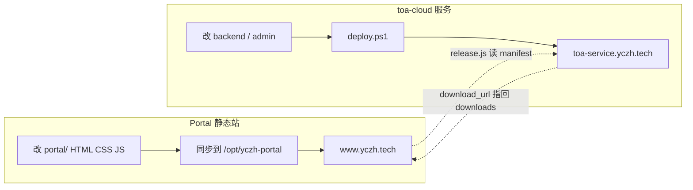
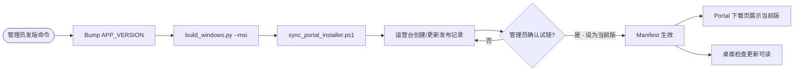
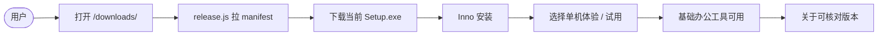
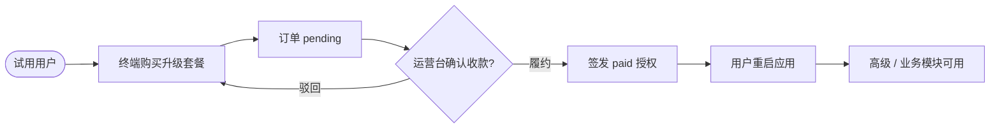

# 27 · Portal 发版与商业升级子流程

> 状态：**现行口径**（2026-08-28）  
> 关联：`toa-cloud/docs/版本发布SOP.md` · Portal `downloads/release.js` · `APP_VERSION`（`app/version.py`）

## 0. 真相源（禁止多处手写版本）

| 数据 | 唯一写入点 | 只读消费方 |
|------|------------|------------|
| 软件版本号 | `TOA3/app/version.py` → `APP_VERSION` | 打包产物名、状态栏、关于弹窗 |
| 当前 stable + 下载直链 + 更新说明 | 运营台「版本发布」→ `toa_releases` | Desktop `update_check`、Portal `toa-release.js` |
| 安装包文件 | `sync_portal_installer.ps1` → `/opt/yczh-portal/downloads/` | manifest 的 `download_url`（Portal HEAD 校验） |

**Portal 读取方式**

- 公共脚本：`portal/toa-release.js` → `GET …/manifest?format=json`
- 下载页：`downloads/release.js` 渲染版本/说明/按钮；`download_url` 即安装包直链
- 首页 TOA 卡片：`ToaRelease.bindVersionTag()` 同步当前版
- manifest 扩展字段：`published_at`、`installer_filename`（与运营台发版记录一致）

**硬规则**

1. Portal **不得**在 HTML 中手写 Setup 版本或推荐包列表。
2. manifest 不可达时 **不**展示兜底旧版，仅提示联系管理员。
3. `deploy.ps1` **不**自动改 manifest；设为当前版必须管理员在运营台确认。
4. 终端**仅**在状态栏永久区与「关于」弹窗展示版本号；其它页只链到上述入口，不重复展示。
5. `config/app.yml` 内 `app_version` 为历史字段，**不参与**运行时展示；发版只 bump `app/version.py`。

---

## 1. Portal + 运营台部署流程



| 步骤 | 动作 | 说明 |
|------|------|------|
| P1 | 改 Portal 仓库静态页 | `portal/index.html` · `downloads/` · `style.css` |
| P2 | 同步到服务器 `/opt/yczh-portal` | scp / 既有 portal 部署脚本；**不含**改 manifest |
| C1 | 改 toa-cloud 代码 | API / 运营台 UI |
| C2 | `deploy.ps1` | 部署 `/opt/toa-cloud`；**不含**安装包、**不含**自动写版本 |
| 验收 | 打开 downloads + manifest JSON | 版本一致；CORS 允许 `www.yczh.tech` |

---

## 2. 打包发行流程



命令备忘：

```powershell
# 1 打包
cd TOA3
python packaging/build_windows.py --clean --msi

# 2 上传安装包到 Portal
powershell -File ..\toa-cloud\deploy\sync_portal_installer.ps1 -ReleaseVersion 3.1.2

# 3 人工：https://toa-service.yczh.tech/admin/app.html → 版本发布
#    download_url = https://www.yczh.tech/downloads/TOA3-Setup-v3.1.2.exe
#    试链 → 勾选「设为当前版」

# 4 验收
#    GET …/manifest?format=json
#    打开 https://www.yczh.tech/downloads/
```

---

## 3. 用户下载试用流程



| 用户感知 | 系统行为 |
|----------|----------|
| 下载页只有一个主按钮 | 来自运营台 `is_current` 记录 |
| 单机体验可用 | 本地 `local_free` / trial 策略，不依赖 DMS |
| 检查更新 | `services/update_check.py` ↔ 同一 manifest |

---

## 4. 用户升级高级功能流程



| 步骤 | 角色 | 落点 |
|------|------|------|
| 提交购买 | 用户 | 桌面商业弹窗 / 订单申请 |
| 确认履约 | 管理员 | 运营台「订单管理」→ 确认收款并签发 |
| 生效 | 用户 | 重启后拉授权；菜单按 entitlement 开放 |

两道人工闸门：**发版设当前版**、**订单履约确认**。智能体可构建与建草稿，不可跳过闸门。

---

## 5. 一致性检查清单

发版或改 Portal 后勾选：

- [ ] `APP_VERSION` = 安装包文件名中的版本
- [ ] 运营台当前版 `download_url` 可 200 下载
- [ ] `GET …/manifest?format=json` 的 `version` / `download_url` 正确
- [ ] `https://www.yczh.tech/downloads/` 主按钮指向同一文件
- [ ] 首页 TOA 卡片版本标签与 manifest 一致（JS 拉取）
- [ ] 手册只链到 `/downloads/`，不写死 Setup 文件名
- [ ] 桌面「关于 → 检查更新」识别为最新；`config/update_manifest.yml` 与线上同号
- [ ] 终端除状态栏与关于外，无静态版本号展示
- [ ] `packaging/dist/release_record.json` 与 `APP_VERSION` 一致
- [ ] 发版后已跑 `python scripts/sync_release_version.py --from-live --require-match --commit`（或上传脚本已自动提交）

**版本统一命令**

```powershell
# 运营台设为当前版之后（测试回退清单 = 生产 stable = APP_VERSION）
python scripts/sync_release_version.py --from-live --require-match --commit
```
