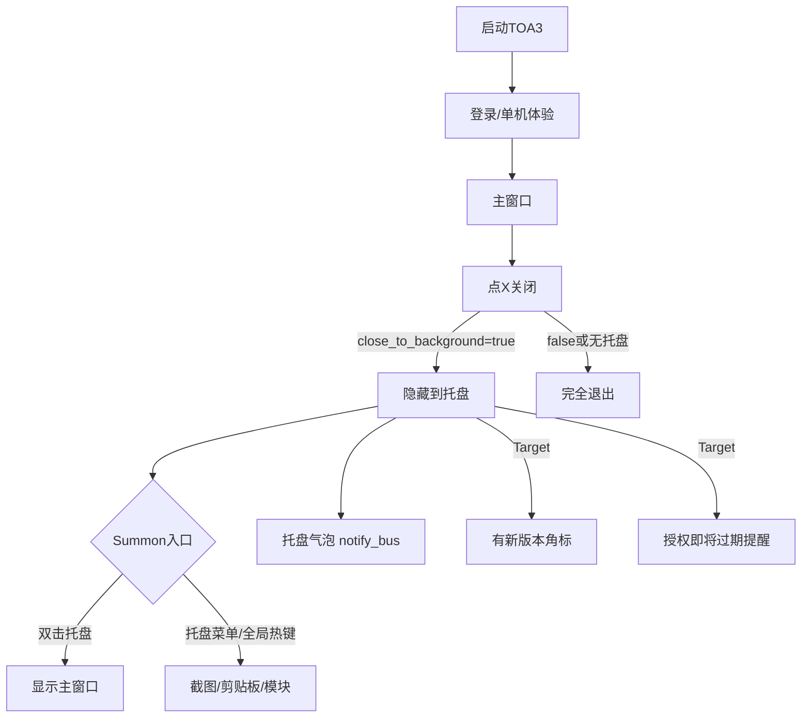
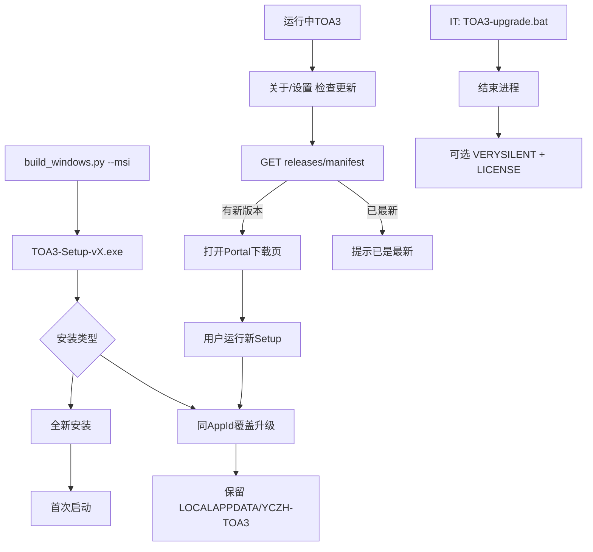
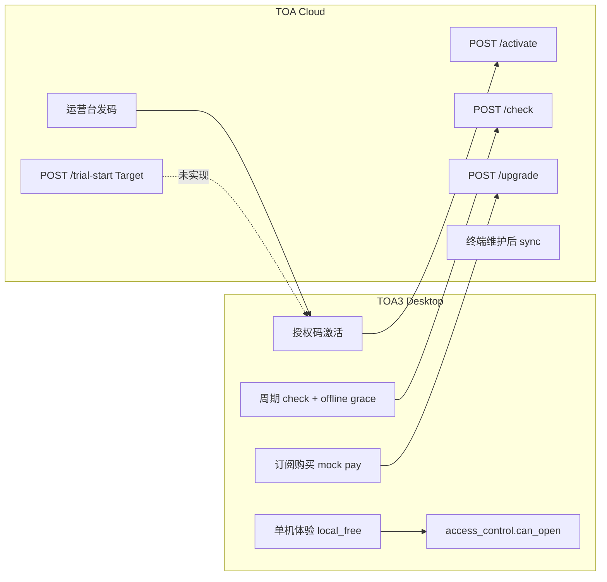

# TOA3 · 托盘 / 打包升级 / 授权管理 · Figma 完整产品规划

## 规划目标

产出一份**可评审、可验收、可拆开发任务**的 Figma 产品蓝图，覆盖三条主线：


| 主线       | 桌面端（TOA3.exe）    | 云服务（toa-service.yczh.tech） |
| -------- | ---------------- | -------------------------- |
| **托盘**   | 后台驻留、Summon、通知   | —                          |
| **打包升级** | 安装/升级/检查更新 UX    | 版本发布 manifest + Portal 下载  |
| **授权管理** | 登录/激活/订阅/续费/模块门禁 | 运营台台账/订单/发码/发布             |


**范围口径**（你已确认）：**现状 + 目标态** — 现有代码能力如实呈现，缺口（试用、托盘联动更新、menu_registry 托盘菜单、一键升级等）以「Target」标注。

**真相源**（设计前必读）：

- 授权架构：[docs/architecture/16-TOA授权与单机联网模式规划.md](docs/architecture/16-TOA授权与单机联网模式规划.md)
- 托盘实现：[services/tray_service.py](services/tray_service.py) · 壳层接线：[app/shell.py](app/shell.py)
- 升级链路：[packaging/build_windows.py](packaging/build_windows.py) · [packaging/toa3_setup.iss](packaging/toa3_setup.iss) · [services/update_check.py](services/update_check.py)
- 授权 UI：[app/login_dialog.py](app/login_dialog.py) · [modules/system_settings/activation_section.py](modules/system_settings/activation_section.py) · [modules/system_settings/license_section.py](modules/system_settings/license_section.py)
- 设计 token：[config/themes/toa_complete.json](config/themes/toa_complete.json) · 布局：[config/ui_spec.yml](config/ui_spec.yml)

---

## 交付物结构（Figma 文件组织）

```text
FigJam Board: 「TOA3 · 托盘·升级·授权 · 产品规划」
├── 1. 产品地图 & 角色
├── 2. 端到端用户旅程（3 条泳道）
├── 3. 信息架构 & 状态机
└── 4. 缺口清单（现状 vs 目标）

Figma File: 「TOA3 · Platform UX v1」
├── 📐 Foundations（从 toa_complete.json 抽 token）
├── 🖥 Desktop · Tray
├── 🖥 Desktop · Upgrade
├── 🖥 Desktop · License
├── ☁ Cloud Admin · License & Releases
├── 🔗 Flow Prototypes（关键路径连线）
└── 📋 Spec Annotations（现状/目标/验收）
```

---

## Phase 1 · FigJam — 旅程与信息架构（先做）

### 1.1 角色与触点矩阵


| 角色        | 主要触点                                                       |
| --------- | ---------------------------------------------------------- |
| **普通用户**  | 登录窗、托盘、关于/检查更新、激活与订阅、续费弹窗                                  |
| **企业 IT** | Inno 安装包、`TOA3-upgrade.bat`、静默 `/VERYSILENT` + `/LICENSE=` |
| **运营管理员** | `https://toa-service.yczh.tech/admin/` 授权台账/订单/版本发布        |
| **开发/内测** | `app.dev.yml` 配置、dev 安装包                                   |


### 1.2 三条端到端旅程（FigJam 泳道图）

**旅程 A · 托盘与后台驻留**




**现状标注**：托盘菜单硬编码于 [tray_service.py](services/tray_service.py)；无更新/授权入口；`close_to_background` 仅 yaml 配置、设置页无 UI。

**目标标注**：

- 托盘二级菜单来自 `menu_registry` + 热键配置（与 [toa3-office-suite-shell.mdc](.cursor/rules/toa3-office-suite-shell.mdc) 双轨一致）
- 托盘顶栏：版本号 + 授权状态摘要
- 有新版本时托盘图标/badge + 「检查更新」菜单项
- 设置页增加「关闭时最小化到托盘」开关

---

**旅程 B · 打包升级**




**现状标注**：无启动时自动检查；无应用内下载；版本号分散于 `version.py` / `toa3_setup.iss` / `app.yml` / `update_manifest.yml`；[about_dialog.py](app/about_dialog.py) 同步调用 `check_for_update()`。

**目标标注**（产品规划层，不要求一次实现）：

- 启动后后台轻量检查 → 托盘/关于 badge（不阻塞进页）
- 「发现新版本」对话框：版本说明 + **打开下载** + **复制升级脚本路径** + IT 静默说明
- 可选 P2：应用内下载 Setup + 调起 `TOA3-upgrade.bat`
- 安装向导 Screen：覆盖/卸载旧版、保留用户数据、可选导入授权码（`/LICENSE=`）

---

**旅程 C · 授权管理（桌面 ↔ 云）**




**四层权限模型**（FigJam 单独一页）：L1 运行模式 → L2 entitlement → L3 feature_packs → L4 绑机 → `can_open(module_id)`。

**现状 UI 面**：

- 登录：[app/login_dialog.py](app/login_dialog.py) — 单机体验 + 授权码；**无「开始试用」**
- 设置 Tab：授权管理（admin）· 激活与订阅（未授权）· 关于与应用
- 续费：[app/renew_dialog.py](app/renew_dialog.py) + license_watchdog

**目标标注**：

- 登录增加「开始试用」（手机 + machine_id → trial-start）
- L2 `entitlement` 字段在 UI 可读（试用中/正式/过期/吊销）
- 托盘/状态栏联动授权状态；过期前 N 天提醒
- 云侧 revoke/unbind 仍走「终端维护 → sync」策略（在 FigJam 注明运维 SOP）

### 1.3 FigJam 缺口清单页（评审用）


| 域                | 现状      | 目标               | 优先级                |
| ---------------- | ------- | ---------------- | ------------------ |
| 托盘菜单             | 硬编码 8 项 | menu_registry 驱动 | P0                 |
| 托盘 × 更新          | 无       | badge + 菜单入口     | P1                 |
| 托盘 × 授权          | 无       | 状态摘要 + 过期提醒      | P1                 |
| close_to_tray 设置 | 仅 yaml  | 设置页开关            | P2                 |
| 试用流程             | 文档有、代码无 | 登录 + API         | P0                 |
| 自动更新提示           | 无       | 后台检查 + 非阻塞提示     | P1                 |
| 版本号单一来源          | 4 处维护   | 构建时生成            | P2（工程，FigJam 标注即可） |


---

## Phase 2 · Figma Foundations

从 [config/themes/toa_complete.json](config/themes/toa_complete.json) 建立 Variables / Styles（不必 11 套主题全做，以 **office 商务蓝 light** 为默认规划稿）：


| Token 类      | 来源键                                                                             | 用途                      |
| ------------ | ------------------------------------------------------------------------------- | ----------------------- |
| Color        | primary / success / warning / danger / surface*                                 | 按钮、SemanticLabel、卡片     |
| Layout       | ui_spec shell 1280×920、dialog login 520、settings 560                            | Frame 尺寸                |
| Typography   | theme font 栈（Microsoft YaHei UI 系）                                              | 中文办公场景                  |
| Component 基元 | PrimaryButton / SecondaryButton / SemanticLabel / FormSection / DialogButtonRow | 对应 [widgets/](widgets/) |


**组件库最小集**（Desktop）：

- Dialog（login / medium / settings）
- FormSection + HintLabel
- TrayMenu（Windows 原生风格示意 + TOA 品牌区）
- TrayBalloon
- StatusBar snippet（授权/版本）

**组件库最小集**（Cloud Admin）：

- Admin shell（侧栏 + 顶栏，对齐 toa-cloud/admin 四模块）
- DataTable + 操作列
- 表单（发码/发布版本）

---

## Phase 3 · Desktop 高保真 Screen 清单

### 3.1 托盘（7 frames + 组件）


| Frame | 内容                                    | 现状/目标        |
| ----- | ------------------------------------- | ------------ |
| T1    | 托盘图标 normal / hover / 有新版本 badge      | Target badge |
| T2    | 右键菜单 · **现状**（硬编码列表）                  | Current      |
| T3    | 右键菜单 · **目标**（分组：Summon / 系统 / 授权与更新） | Target       |
| T4    | 双击恢复主窗口                               | Current      |
| T5    | 关闭到托盘气泡「已最小化…」                        | Current      |
| T6    | 授权即将过期托盘提醒                            | Target       |
| T7    | 发现新版本托盘提醒 → 打开更新对话框                   | Target       |


### 3.2 打包升级（10 frames）


| Frame | 内容                                         |
| ----- | ------------------------------------------ |
| U1    | 关于对话框 · 版本信息 + 检查更新（Current）               |
| U2    | 检查中 / 已是最新 / 发现新版本（三种 SemanticLabel 态）     |
| U3    | 发现新版本 · **目标**增强对话框（changelog + 下载 + 升级说明） |
| U4    | Inno 安装向导 · 欢迎页（全新 vs 升级文案差异）              |
| U5    | 安装向导 · 目录选择（%LOCALAPPDATA%\Programs\TOA3）  |
| U6    | 安装向导 · 进行中 + 结束页                           |
| U7    | 卸载向导 · 可选删除用户数据                            |
| U8    | IT：`TOA3-upgrade.bat` 说明页（FigJam 可链接）      |
| U9    | 设置 · 关于与应用（嵌入检查更新）                         |
| U10   | **Target** 启动后非阻塞更新提示（toast/托盘，不打断进页）      |


### 3.3 授权管理 · 桌面（12 frames）


| Frame | 内容                                      |
| ----- | --------------------------------------- |
| L1    | 登录 · 单机体验 + 授权码（Current）                |
| L2    | 登录 · **Target** 增加「开始试用」第三入口            |
| L3    | 登录 · 激活中 / 失败态（bound_elsewhere、revoked） |
| L4    | 设置 · 激活与订阅（ActivationSection + 订阅购买）    |
| L5    | 订阅 · 功能包列表 + mock 支付成功                  |
| L6    | 续费对话框 RenewDialog                       |
| L7    | 设置 · 授权管理（admin LicenseSection 台账 CRUD） |
| L8    | 关于与应用 · 未授权嵌入 ActivationSection         |
| L9    | 状态栏 · 授权有效期文案                           |
| L10   | license_watchdog · 过期/吊销 blocking 提示    |
| L11   | 模块门禁 · 无权限打开某 module 的提示                |
| L12   | **Target** 离线宽限期 UI（grace 2 天说明）        |


---

## Phase 4 · TOA 云服务 Admin Screen 清单

基于 `toa-cloud/admin` 四模块 + API 能力，规划 **8 frames**：


| Frame | 模块              | 关键字段/操作                                |
| ----- | --------------- | -------------------------------------- |
| C1    | 登录              | `/api/auth/login`                      |
| C2    | 授权台账列表          | 手机、pack、过期、绑机、状态                       |
| C3    | 发码/新建授权         | register → 生成 TOA2- 码                  |
| C4    | 授权详情            | check 状态、**注明 revoke 须走终端**            |
| C5    | 功能包             | sellable packs → 桌面订阅页                 |
| C6    | 订单列表            | 订单号、支付态、履约                             |
| C7    | 版本发布            | product=TOA3、channel=stable → manifest |
| C8    | **Target** 试用台账 | trial-start 记录（与 L2 对应）                |


Cloud ↔ Desktop 连线在 Figma Prototype 用 **标注 + 编号**（如 API-ACTIVATE-01）与 FigJam 旅程对应。

---

## Phase 5 · 原型与验收标注

### 关键可点击原型路径（Figma Prototype）

1. **新用户**：L1 单机体验 → 主窗 → T5 关到托盘 → T2 截图热键
2. **付费升级**：L4 订阅购买 → L5 支付 → 模块解锁（gate 前后对比）
3. **版本升级**：U1 检查更新 → U3 下载说明 → U4 安装向导
4. **运营发码**：C3 发码 → L3 用户激活 → C2 台账状态变更
5. **Target 试用**：L2 开始试用 → C8 试用记录

### 每 Frame 统一标注层

- **Current / Target** 标签
- 关联代码路径（如 `tray_service.py:L47-89`）
- 验收步骤（对齐 [toa3-feature-acceptance.mdc](.cursor/rules/toa3-feature-acceptance.mdc)）
- 禁止项：进页/托盘路径同步 30s 联网探测

---

## Phase 6 · 执行方式（Figma MCP 工作流）

按你选择的 **FigJam 先行** 顺序：

1. **create_new_file** → 创建 FigJam board + 关联 Figma 设计文件
2. **FigJam**：用 `generate_diagram` 生成三条 mermaid 旅程 + 缺口表
3. **Figma Foundations**：从 `toa_complete.json` 写 Variables（figma-generate-design 流程）
4. **分域增量**：Tray → Upgrade → License Desktop → Cloud Admin（每域先 Section 框架再填 Screen）
5. **Desktop 校准**：对运行中 TOA3 关键对话框（登录/关于/设置）用 `generate_figma_design` 截图像素参考，再替换为组件实例
6. **评审包**：FigJam 链接 + Figma 只读链接 + 缺口清单导出 PNG

**不在本次 Figma 范围**（避免 scope 膨胀）：Wave★ 八件套业务页、Harness 内嵌 Web、DMS 交付系统。

---

## 评审检查清单（主理人过稿用）

- [ ] 三条旅程是否覆盖 **安装 → 日常使用 → 升级 → 授权变更 → 退出** 全周期？
- [ ] 托盘是否满足「壳内可发现 + 系统可唤起」双轨，且不与第二菜单冲突？
- [ ] 升级路径是否明确 **Portal 下载 vs IT 静默** 两条线？
- [ ] 授权是否体现 **单机不冒充完整版** + 离线宽限 + 云台账独立？
- [ ] 所有 Target 帧是否有对应缺口行与建议优先级？
- [ ] 云 Admin 是否与桌面 UI 字段名一致（TOA2- 码、pack_id、machine_id）？

---

## 建议排期


| 阶段                        | 产出              | 预估      |
| ------------------------- | --------------- | ------- |
| FigJam 旅程 + 缺口            | 可评审.board       | 0.5–1 天 |
| Foundations + Tray        | T1–T7           | 0.5 天   |
| Upgrade + License Desktop | U1–U12 + L1–L12 | 1–1.5 天 |
| Cloud Admin               | C1–C8           | 0.5–1 天 |
| Prototype + 标注            | 5 条路径 + 验收层     | 0.5 天   |


**合计约 3–4 个工作日**（含一轮主理人反馈修订）。