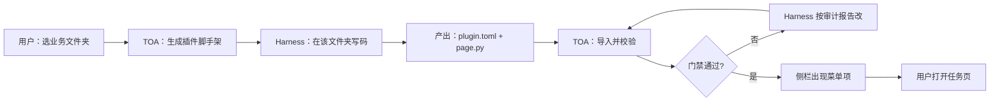

# ARCH-07 · 用户扩展范式

> 状态：**approved**（用户自扩展沙箱口径 · 2026-08-29）  
> 关联：ARCH-01 · ARCH-05 · SOP-06 · Skill `toa3-sop-user-extension` / `toa3-sop-new-feature`  
> 目标：终端用户在 **本机 TOA 用户区** 安全扩展个性化功能；**不破坏宿主、不影响电脑其它软件、只作用于当前用户的 TOA**。

---

## 0. 产品主张（主理人口径）

| 主张 | 含义 |
|------|------|
| **自主扩展** | 用户用 Harness 按契约做自己的侧栏功能 |
| **个性化** | 适配单位/个人场景，不必等官方发版 |
| **不破坏 App** | 禁止改安装包/源码树；导入审计拦截危险 API |
| **不影响电脑** | 禁止系统目录、注册表、未声明 shell/联网 |
| **只作用于自己的 TOA** | 代码与登记在 `data/user/`；卸载即回官方态 |
| **清晰不割裂** | **单一入口**顶栏「系统 → 扩展」：添加 → 开发 → 打开 / 移除；Harness 只作开发能力 |
| **岗位进化** | 为 FDB 等岗位而生：常用效率套件 → 业务能力 → 本机可进化扩展，推动个人与团队角色升级 |

**Harness = 引用的强大智能体能力；扩展 = 系统自我进化（用户插件）；TOA = 沙箱宿主。**

### 能力分层（产品叙事）

```text
① 办公套件集成     剪贴板 / 截图 / 目录 / 文件…（装即集成）
② 相互业务能力     培训运营、台卡、日程等业务模块
③ 作用于终端本机   「扩展」让用户按岗位改写自己的 TOA
         ↓
   真正的效率工具 → 影响个人与团队角色转变（FDB 岗位主线）
```

DeepSeek Harness 落在顶栏「引擎 → 编码智能体」：是被引用的强插件能力，**不是**扩展管理入口，也**不**再进系统设置能力接入。

### 固定位置（多扩展分管）

```
data/user/extensions/           ← 扩展总目录
  <扩展A>/ plugin.toml + AGENTS.md + modules/…
data/user/plugins.yml           ← 菜单登记
```

入口：顶栏 **系统 → 扩展**（`modules/user_extensions/`，`feature_id=user_extensions` 可方案打包）。

### 生命周期（一致性闭环）

```text
① 添加名称
② 创建目录 + plugin.toml + AGENTS.md（绝对路径红线）
③ 写入 plugins.yml 登记
④ 登记 Harness workspace.json
⑤ 打开智能体：切工作区 → 新会话 → 填入开发任务
⑥ 用户确认「开发完成」→ 业务侧栏可用（或重启）
⑦ 「移除」：取消登记 + 删目录 + 清工作区记录
```

编排入口：`services/extension_lifecycle.py`。

### 小白一句话（Skill）

| 项 | 说明 |
|----|------|
| Skill | `.cursor/skills/toa3-sop-user-extension/SKILL.md` |
| CLI | `python scripts/create_user_extension.py --name "功能名"` → 默认 `group=business` + 登记 |
| 智能体快捷指令 | Harness「一句话扩展」 |
| 用户话术 | 「帮我做一个××，放到业务」 |
| 移除 | 系统设置 → 扩展 → **移除**（取消登记并删除扩展目录） |
| 边界 | **不改**宿主与智能体安装；官方新功能仍走 `toa3-sop-new-feature` |

---

## 1. 先分清三种「插件」（禁止混称）

| 名称 | 是什么 | 谁管理 | 能否进 TOA 侧栏 |
|------|--------|--------|-----------------|
| **dsh / Cordis 插件** | DeepSeek Harness 官方生态扩展 | Harness Web / `dsh plugin` | **否**（红线：见 doc 18） |
| **TOA 内置模块** | 官方 `modules/<id>/` + `app.yml` | 发版/主理人 | 是 |
| **TOA 业务插件包（本范式）** | 用户/业务方按契约生成的 `BasePage` 包 | 用户目录 + TOA 导入器 | **是（经门禁）** |

本文件只定义第三种。**禁止**在 TOA 壳内做 dsh 插件安装器。

---

## 2. 端到端主路径（用户可感知）



| 步骤 | 谁做 | TOA 提供什么 |
|------|------|--------------|
| 1. 选文件夹 | 用户 | 「新建业务插件」对话框：根目录、模块 id、显示名、归属子模块（group） |
| 2. 脚手架 | TOA | 写入契约文件 + `AGENTS.md`（TOA 开发铁律）+ 空 `BasePage` 骨架 |
| 3. 开发 | Harness | 工作区 = 该文件夹；按 AGENTS/脚手架改页与 service |
| 4. 导入 | TOA | 扫 `plugin.toml`，跑静态审计，登记 `data/user/plugins.yml` |
| 5. 挂菜单 | TOA | `rebuild_nav`；侧栏出现该项；懒加载页面 |
| 6. 卸载/隐藏 | TOA | 改 `show` 或移除登记；不删源码除非用户确认 |

---

## 3. 插件包契约（文件夹标准 · 硬合同）

### 3.1 目录形态

```
<plugin_root>/                    # 用户选定的文件夹
  plugin.toml                     # 必填：清单（真相源）
  AGENTS.md                       # TOA 生成：开发铁律（给 Harness 读）
  README.md                       # 可选：业务说明
  modules/
    <plugin_id>/
      __init__.py
      <plugin_id>_page.py         # class XxxPage(BasePage)
      service.py                  # 可选：无 QWidget
  assets/                         # 可选：样例/图标
  tests/                          # 可选：自测脚本
```

> **加载方式**：宿主用 `importlib` **按文件路径**加载入口 `.py`，不把插件根塞进 `sys.path`，避免与官方 `modules` 包名冲突。

### 3.2 `plugin.toml` 最小字段

```toml
schema_version = 1

[plugin]
id = "biz_leave_card"             # snake_case，全局唯一，禁止与内置 id 冲突
name = "请假台卡"
group = "business"                # 必须 ∈ GROUP_ORDER
order = 90
version = "0.1.0"
requires_license = false          # 默认免费；付费能力须显式 true + feature_id
feature_id = ""                   # 可选 SKU
author = ""
description = "按班级名单生成请假台卡"

[entry]
module_path = "modules.biz_leave_card.biz_leave_card_page"
class_name = "BizLeaveCardPage"
page_id = "biz_leave_card"

[storage]
# 可选；缺省用 storage_paths 约定
data_key = "biz_leave_card"

[safety]
allow_network = false             # 默认禁联网；真要联网须走 integrations 声明
allow_shell = false               # 默认禁 subprocess/os.system
integrations = []                 # 如 ["ocr"]，须已在 integrations.yml 登记
```

### 3.3 代码铁律（写入 `AGENTS.md`，Harness 必遵）

1. 页面必须 `BasePage`；控件只来自 `widgets/`；**禁止** `setStyleSheet` / 硬编码色 / 裸 `QMessageBox`
2. 生成完成用 `show_saved`；状态用 `report_status`
3. 路径只经 `storage_paths` / `plugin_data_dir(plugin_id)`
4. 外部 API 只经 `services.integrations.get_client`；且 `plugin.toml` 已声明
5. **禁止**改 `app/shell.py`、`menu_registry.MIGRATED_MODULES`（内置表）、`resources/qss`
6. 单模块单主任务；不自建顶栏/第二套菜单
7. 进页路径禁止同步长联网

---

## 4. TOA Host 能力（相对 Harness 的独有价值）

| 能力 | 为何必须在 TOA | 落点（目标态） |
|------|----------------|----------------|
| 脚手架生成 | 保证契约与 AGENTS 一致 | `services/plugin_scaffold.py` |
| 导入/审计 | 防止坏代码拖垮壳 | `services/plugin_loader.py` + `scripts/audit_plugin.py` |
| 动态登记菜单 | 用户侧栏可扩展且不污染官方 `app.yml` | `data/user/plugins.yml` + `menu_registry` 合并 |
| 运行时加载 | `importlib` 从插件根加载 entry | `app/module_loader.py` 扩展 |
| 启停 Harness 工作区 | 一键把 Harness `default_workspace` 指到插件根 | 已有 `harness_workspaces` 增强 |
| 卸载与隔离 | 出错可关 `show:false`，不影响内置模块 | 插件注册表 |

**仍禁止（延续 doc 18）：** TOA 内 dsh 插件商店、自研聊天替代 `dsh web`、改 Harness CSS。

---

## 5. 菜单挂载规则（与现有壳一致）

### 5.1 数据流

```
官方 menu_items (app.yml)
        +
用户覆盖 (data/user/menu.yml)          # 显隐/排序
        +
插件登记 (data/user/plugins.yml)       # 新增 · 本范式
        ↓
menu_registry.grouped_menu_items()
        ↓
shell.rebuild_nav / _ensure_page
```

### 5.2 `plugins.yml` 示例

```yaml
plugins:
  - id: biz_leave_card
    root: "D:/work/toa-plugins/biz_leave_card"
    show: true
    imported_at: "2026-08-29T12:00:00"
    status: mvp          # stub | mvp | done（用户插件默认 mvp）
    gaps: []
```

### 5.3 加载优先级

1. **内置** `MIGRATED_MODULES` 永远优先；插件 id **不得**覆盖内置 id  
2. 插件 entry 仅当 `show: true` 且审计通过  
3. 失败时侧栏可显示但打开为「插件加载失败」页（带修复指引），**禁止**静默 Stub 假绿灯

### 5.4 与发行包关系

- **正式安装包**：不打入用户插件源码  
- **开发版**：可调试 `modules/plugins/` 镜像目录（可选）  
- 用户插件路径写在 `data/user/`，随本机配置走

---

## 6. 安全与品质门禁（导入时强制）

| 门禁 | 规则 | 失败处理 |
|------|------|----------|
| 契约 | `plugin.toml` 可解析且字段合法 | 拒绝导入 |
| id 冲突 | 不与 `MIGRATED_MODULES` / 已装插件重复 | 拒绝 |
| 静态扫描 | 禁 `setStyleSheet(`、裸 `QMessageBox`、未声明的 `urllib`/`subprocess` | 报告 + 拒绝或仅 stub |
| 入口 | `class_name` 可 import 且是 `BasePage` 子类 | 拒绝 |
| 控件 | 粗检未从 `widgets` 外 new 主按钮（启发式） | 警告写入 gaps |
| 授权 | `requires_license` 走 `access_control` | 与内置一致 |

用户插件**默认不走**官方 Top3 共创门禁（那是产品内置功能流程）；改为：

- **导入审计** + **用户自验清单**（见 §8）
- 若插件拟**合入官方发版**，再强制走 `toa3-sop-new-feature` + Top3

---

## 7. Harness 协作约定（开发范式）

### 7.1 推荐工作流（给用户与智能体）

1. TOA：「新建业务插件」→ 选文件夹 → 生成脚手架  
2. TOA：「在 Harness 中打开」→ Sidecar 工作区 = 插件根  
3. 用户对 Harness 说：「按 AGENTS.md 实现 XXX，控件只用 widgets」  
4. 改完 → TOA：「导入/刷新插件」→ 看审计报告  
5. 通过 → 侧栏可用；失败 → 把审计报告投喂回 Harness 继续改  

### 7.2 Harness 提示词骨架（脚手架内嵌）

```text
你是 TOA3 业务插件开发代理。只改本插件目录。
必须遵守 AGENTS.md 与 plugin.toml。
页面继承 BasePage；UI 只用 widgets/；落盘用 storage_paths。
不要修改 TOA 壳层、QSS、menu_registry 内置表。
完成后保证 python -c "from <entry> import <Class>" 可导入。
```

### 7.3 与「选文件夹」的关系

| 动作 | 含义 |
|------|------|
| 选文件夹作 **插件根** | 本范式：产出可挂菜单的 TOA 页 |
| 选文件夹作 **Harness 工作区** | 仅 Agent 上下文；**不会**自动挂菜单 |

二者可合一（推荐）：插件根 = Harness workspace。

---

## 8. 用户自验清单（导入后）

- [ ] 侧栏出现正确名称与子模块  
- [ ] 打开页无报错；主题切换后控件正常  
- [ ] 主路径能完成业务输出；生成类有 `show_saved`  
- [ ] 数据落在 `data/module/<id>/` 或插件声明路径  
- [ ] 卸载/隐藏后侧栏消失，其它模块不受影响  

---

## 9. 三独到处（草案 · 待主理人论证）

> 按 `toa3-feature-top3-research`：须主理人确认后才能写业务实现。

| # | 主张 | 用户可感价值 | 可测验收 |
|---|------|--------------|----------|
| 1 | **契约脚手架 + AGENTS，而不是空白文件夹裸聊** | 选目录后立刻有可跑骨架与铁律，Harness 不易跑偏 | 新建插件 → 目录含 `plugin.toml`+`AGENTS.md`+可 import 空页 |
| 2 | **导入审计门禁，坏插件进不了正式侧栏** | 乱写代码不会拖垮套件 | 故意放 `setStyleSheet` → 导入失败并给出修复点 |
| 3 | **用户插件登记与官方菜单分离** | 升级 TOA 不冲掉自研菜单；内置模块不被覆盖 | 升级/重装后 `plugins.yml` 仍在；同名 id 冲突被拒 |

**对标 Top3（草案，详细可落 research 文档）：**

| 产品 | 可学 | 不学 |
|------|------|------|
| VS Code Extension | manifest + 激活事件 | 重型 marketplace 与 webview 沙箱全抄 |
| Obsidian 社区插件 | 文件夹即插件、热加载 | 无审计随意 eval |
| Cursor / Agent 写项目 | 文件夹工作区 + 规则文件 | 直接改宿主内核 |

---

## 10. 分期落地（建议）

| 阶段 | 交付 | 不做 |
|------|------|------|
| **P0** ✅ | 契约 + `plugin_loader` / `plugins.yml` + `audit_plugin.py` + 样例包 | — |
| **P1** ✅ | 「新建脚手架」「导入」「在 Harness 打开」「导入示例」 | 插件商店（近端不做 VS Code 式；远期软资产见 doc 29/29b） |
| **P2** | 热刷新强化、签名/校验和、本机 zip 管道（doc 29 P2） | dsh 插件管理 |
| **P3** | 软资产目录契约（extension.pack / prompt.card / skill.card） | 交易支付（另立项） |

---

## 11. 代码落点地图（目标态）

| 组件 | 路径 |
|------|------|
| 契约/脚手架 | `services/plugin_scaffold.py` |
| 加载与审计 | `services/plugin_loader.py` · `scripts/audit_plugin.py` |
| 用户登记 | `data/user/plugins.yml` |
| 菜单合并 | `services/menu_registry.py`（读 plugins，不写死进 `MIGRATED_MODULES`） |
| 页加载 | `app/module_loader.py` |
| UI 入口 | **系统设置 → 扩展** · `modules/system_settings/extensions_section.py` |
| Schema 样例 | `assets/samples/toa_plugin_pack/demo_hello/` |
| Skill / CLI | `.cursor/skills/toa3-sop-user-extension/` · `scripts/create_user_extension.py` |
| 发版说明 | `本文「附册 · 原 28b」` |
| 跳转兼容 | `app/plugin_dialog.open_extension_hub` → 打开设置扩展页 |

---

## 12. 否决项（写码前钉死）

- ❌ 把 dsh Cordis 插件直接映射成侧栏菜单  
- ❌ Harness 生成代码直接 `show: true` 写入官方 `app.yml`  
- ❌ 插件内 `setStyleSheet` / 自建主题  
- ❌ 插件改壳层导航或抢占内置 `module_id`  
- ❌ 无审计的任意 `exec` / 动态下发远程代码  
- ❌ 在 Harness 工具栏堆扩展管理（入口只在系统设置）  

---

## 13. 主理人点验清单（隔离 + 一句话进业务）

联调时逐条勾选；未通过不得宣称「小白路径完成」。

| # | 场景 | 期望 | 结果 |
|---|------|------|------|
| 1 | 平时在智能体聊天/写代码 | 工作区不变；未点「开发」则不被扩展打断 | ☐ |
| 2 | 系统设置 → 扩展 → 添加 | 官方侧栏模块仍在；智能体安装/启停不受影响 | ☐ |
| 3 | 智能体「一句话扩展」 | 扩展出现在顶栏 **业务**；代码只在 `data/user/extensions/` | ☐ |
| 4 | 「隐藏」 | 该扩展从侧栏消失；官方菜单仍在 | ☐ |
| 5 | 「移除」 | 侧栏去掉且扩展目录删除；官方与智能体不受影响 | ☐ |

---

## 14. 主理人确认栏

- [x] 三种插件边界同意  
- [x] §9 三独到处逐条同意（或改定后勾选）  
- [x] 分期从 P0/P1 哪档开工同意  
- [x] 文档状态改为 `approved` 后方可实现 P0+  
- [x] 入口统一为「我的扩展」+ Skill 一句话进业务（2026-08-29 修订）  
- [x] 入口迁入系统设置 · 可真正移除 · FDB 岗位进化叙事（2026-08-29 再修订）  

> **状态：approved**（主理人 2026-08-29 确认；同日修订：设置入口 / 移除 / FDB）

**确认前：只维护本文与 research，不写加载器业务代码。**

---

## 附册 · 原 28b / 28c / 28d（已并入本文，2026-09-07）

> 以下三节原为独立文件，现并入本篇以免平行文档。Skill / 旧链接请改指向本文。

### 原文件：28b-我的扩展-发版与数据区.md

# 28b · 我的扩展 · 发版与数据区

> 状态：active · 2026-08-29  
> 关联：架构 28 · Skill `toa3-sop-user-extension`

## 原则

| 项 | 口径 |
|----|------|
| 安装包 | **不带**用户扩展源码；样例仅 `assets/samples/toa_plugin_pack/`（可选演示） |
| 用户数据 | `data/user/extensions/` + `data/user/plugins.yml` 属于本机用户 |
| 升级 | Inno/覆盖安装 **不得删除或覆盖** `data/user/extensions/` 与 `plugins.yml` |
| 卸载 | 默认保留用户数据（与现有 TOA 用户目录策略一致）；勿在卸载脚本清扩展区 |
| 官方菜单 | 仍只来自 `config/app.yml`；用户扩展永不写入官方 yaml |

## 打包检查

- [x] `packaging/` 不拷贝 `data/`；`release_config_guard` 禁止发布树出现 `data/user`
- [x] Inno 安装源仅 `{app}` 程序目录；不清理 `%LOCALAPPDATA%` / 用户 `data/user/`
- [x] 发版 README 写明：升级不影响「系统设置 → 扩展」里的自建功能

## 用户可见一句话

> 软件升级后，**系统设置 → 扩展** 里的功能还在；点「移除」可彻底删掉；坏了也不会弄坏官方功能。

### 原文件：28c-扩展开发安全快稳策略.md

# TOA3 · 扩展开发：安全 / 快速 / 稳妥策略

> 依据「贪吃蛇游戏」Harness 会话 `session-7045b998…` 实审（2026-08-29）制定。  
> 对标 skill：`toa3-sop-user-extension`。扩展总纲即本文（原「增长中心」口径已并入）。

## 1. 实审结论（贪吃蛇那次）

| 项 | 结果 |
|----|------|
| DSH 沙箱 | `workspace-write`（写权限锁在工作区） |
| **写入宿主** | **无**。全部 `write`/`edit` 落在 `data/user/extensions/ext_968073/` |
| 只读宿主 | **有**。Grep/Read `plugin_loader`、`shell`、`app_state`、主题等（策略违规、费时间） |
| Shell 探测 | 列出 TOA 根、`widgets/`、`modules/`、**其它扩展** `ext_967729`（越界窥探） |
| 扩展内冗余 | 曾建 `snake_game.py` / `_smoke_test.py` 后已删；现余 `__pycache__`（可清） |
| 最终产物 | 单文件入口页 + `plugin.toml` + `AGENTS.md` + `README.md` → **可用** |

**一句话**：系统应用文件没被改坏；主要风险是「读宿主 + 乱翻」拖慢且埋隐患，不是写坏宿主。

## 2. 策略目标

1. **安全**：写不出扩展根；读宿主也禁止（靠提示 + 体检，不靠信任）。  
2. **快速**：不调研加载机制；照 `AGENTS.md` 单文件实现主路径。  
3. **稳妥**：完成后自动体检；多余临时文件一键清理；坏了可「移除」重来。

## 3. 强制流程（产品侧）

```
系统设置·扩展 → 添加并去开发
  → Host RPC：工作区 + 会话 + 投喂（skill 红线提示词）
  → 智能体只改扩展目录（workspace-write）
  → 用户点「开发完成」
  → extension_guard 体检 + 清 __pycache__/_smoke*
  → 「打开」→ 顶栏业务
```

## 4. 智能体约束（投喂 + AGENTS）

- 唯一可写：扩展绝对路径  
- **禁止** Read/Grep/Pwsh 指向 `app/`、`services/`、官方 `modules/`、`config/`、其它扩展  
- **禁止**研究 `plugin_loader`；导入约定写死在 AGENTS（单文件入口）  
- 允许调用（不读源码）：`widgets` / `BasePage` / `module_data_dir` / `show_saved`  
- 需求不清只问一句，然后直接实现

## 5. 工程护栏

| 护栏 | 位置 |
|------|------|
| 提示词红线 | `extension_lifecycle.build_dev_task_prompt` |
| AGENTS 模板 | `plugin_scaffold.agents_markdown` |
| 目录/会话体检 | `extension_guard.full_extension_guard` |
| 完成时清理 | `cleanup_extension_junk`（开发完成按钮） |
| Host 登记 | `harness_toolkit` → `workspace.create`（勿只写 json） |
| 沙箱写锁 | DSH `workspace-write`（进开发时 `/permission` 钉死） |
| **读越界硬闸** | `extension_sandbox_watchdog`：cancel + steer |

## 6. 验收清单（主理人）

- [ ] 侧栏出现功能且能完成一次主操作  
- [ ] 「开发完成」体检无 error  
- [ ] `git status` 无因该扩展产生的 `app/`/`services/` 意外改动（本仓其它 WIP 另计）  
- [ ] 扩展目录无 `_smoke*` 残留  

## 7. 已知上限与 TOA 硬闸（2026-08-29）

Harness `workspace-write` **只锁写、不禁读**（上游 `dsh-fs-sandbox`：Reads always pass）。

| 层 | 能力 |
|----|------|
| DSH 沙箱 | 写不出工作区；Read/Grep 仍可扫宿主 |
| 说明书 | `AGENTS.md` + `HOST_API.md`（禁止指路去扫 widgets） |
| **运行时硬闸** | `extension_sandbox_watchdog`：越界**写入**/危险 Shell → `session.cancel`；越界**只读**不打断（DSH `workspace-write` 已禁写） |
| 钉权限 | 进开发时 `/permission workspace-write` |
| 完成后审计 | `extension_guard` 仍记 read_host warning |

彻底内核级禁读需 DeepSeek Harness 上游增强；当前产品以 **中断越界回合** 框死行为。

### 原文件：28d-扩展WebView表面.md

# 28d · 用户扩展 WebView 表面

> 状态：**approved** · 2026-08-30  
> 关联：本文安全节 · [18-引擎与Harness](ARCH-05-引擎与Harness.md)

## 1. 定位

| 表面 | 适用 | 产物 |
|------|------|------|
| `entry.surface = qt`（默认） | 表单、台账、生成类 | `modules/<id>/<id>_page.py` + widgets |
| `entry.surface = webview` | 游戏、可视化、复杂交互 | `ui/index.html` + JS/CSS |

Harness 写 HTML/JS 比 Qt 布局快；宿主提供 **统一 WebEngine 壳 + QWebChannel 白名单桥**，扩展不得自行 `import QWebEngineView`。

## 2. 契约（plugin.toml）

```toml
[entry]
surface = "webview"
web_root = "ui/index.html"
class_name = "WebExtensionHost"   # 占位，运行时由宿主页加载
page_id = "<plugin_id>"
```

- 资源仅放扩展根内，默认 `ui/`
- 导航限制：`file://` 仅限扩展根；`http(s)` 须 `[safety] allow_network = true`
- 与 Harness Guest（dsh web）无关，不共用 URL

## 3. 宿主桥（JS · 对象名 `toa`）

见扩展内 `HOST_API.md`。页面须引入：

```html
<script src="qrc:///qtwebchannel/qwebchannel.js"></script>
<script src="toa_bridge.js"></script>
```

```javascript
TOA.ready(function (toa) {
  toa.reportStatus('就绪', 'success');
});
```

## 4. 代码落点

| 层 | 路径 |
|----|------|
| 宿主页 | `core/extension_web_page.py` |
| QWebChannel 桥 | `services/extension_web_bridge.py` |
| JS 助手（脚手架复制） | `assets/extension_web/toa_bridge.js` |
| 加载分支 | `services/plugin_loader.create_plugin_page` |
| 脚手架 | `services/plugin_scaffold.py`（`surface=webview`） |

## 5. 验收

1. 创建扩展时选「网页界面」→ 目录含 `ui/index.html`
2. 开发完成 → 业务侧栏打开 → WebEngine 显示本地页
3. `toa.reportStatus` 出现在状态栏
4. 未声明 `allow_network` 时外链导航被拦截
5. `python scripts/audit_plugin.py <root>` 通过

样例：`assets/samples/toa_plugin_pack/demo_web/`
